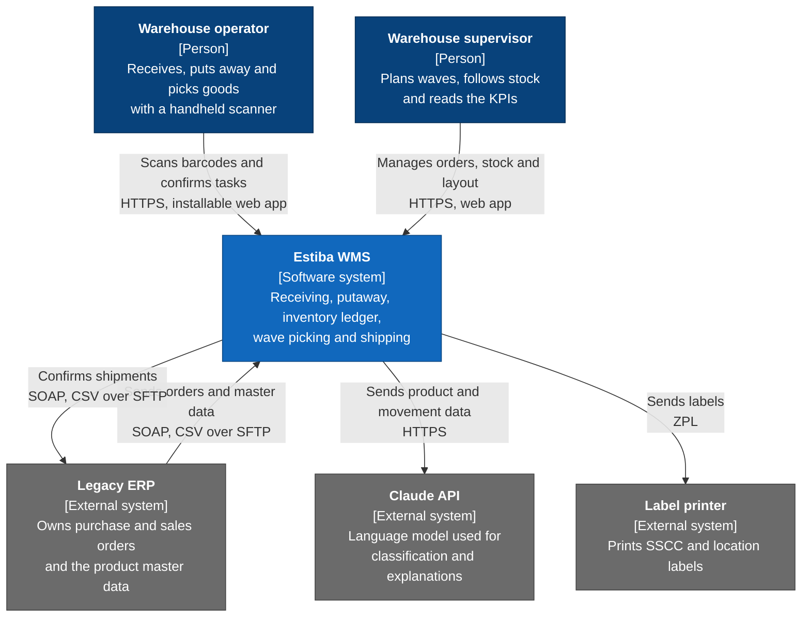

# System context (C4 level 1)

Who uses Estiba WMS and which other systems it talks to. Inside the box is covered by the [ADRs](../adr) and, from E01-06, by the domain model.

## Elements

| Element | Role | Planned in |
|---|---|---|
| Warehouse operator | Works on the warehouse floor with a handheld scanner, using the installable picking app | E07 |
| Warehouse supervisor | Works in the back-office web app | E05, E06 |
| Estiba WMS | The system built in this repository | E01 to E10 |
| Legacy ERP | Simulated ERP exposing SOAP and drop-folder CSV files. Estiba reaches it through an anti-corruption layer | E08 |
| Claude API | Receives only the product and movement data needed for each request. Used for product classification, slotting suggestions and anomaly explanations | E09 |
| Label printer | Receives ZPL generated by Estiba. Printing itself is outside the system | E04 |

## Notes

- Authentication is part of Estiba WMS (JWT, roles `admin`, `supervisor` and `operator`), so there is no external identity provider at this level.
- Every integration with an external system goes through an adapter in the `Infrastructure` layer of the context that needs it (see [ADR 0001](../adr/0001-modular-monolith-with-hexagonal-bounded-contexts.md)).
