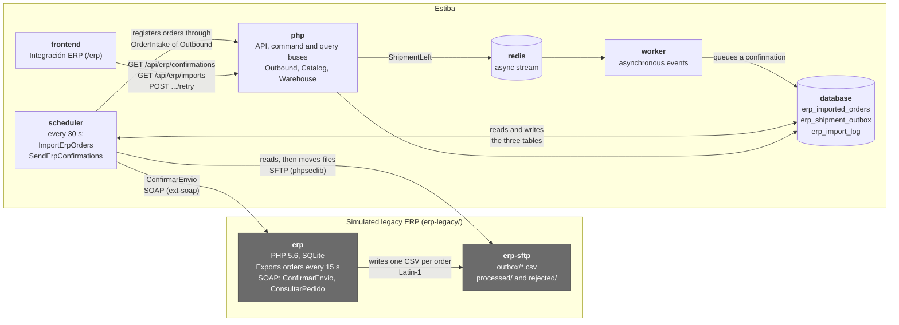
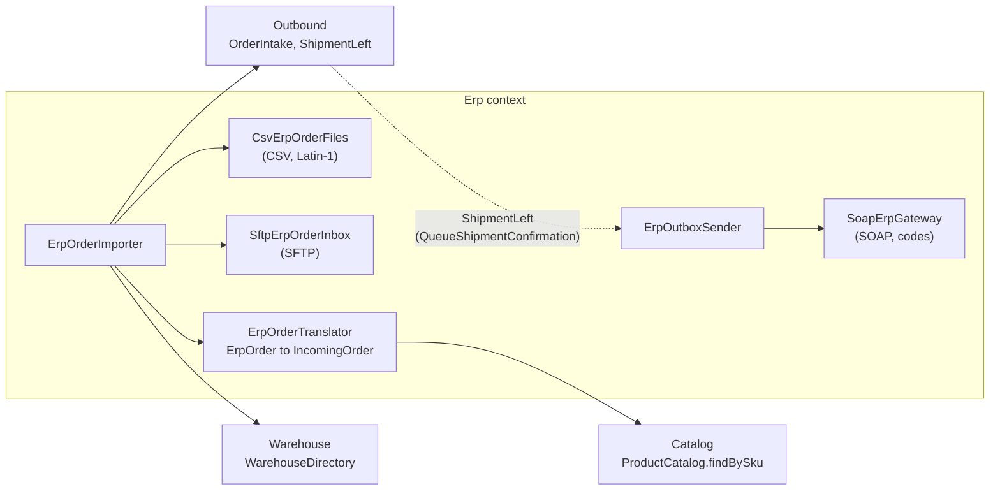
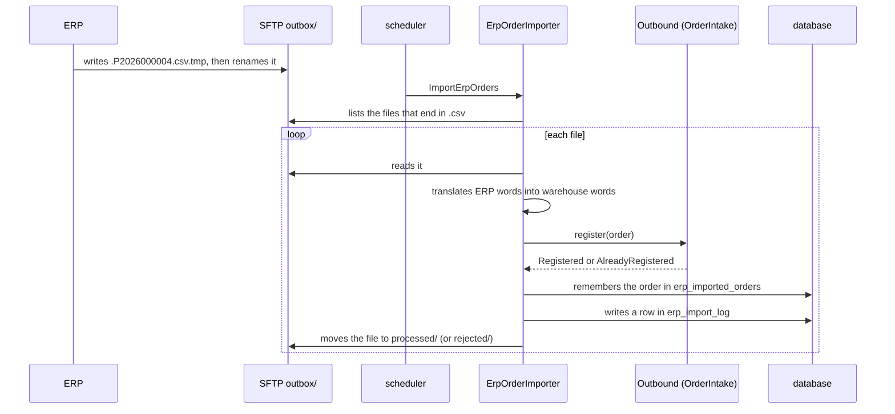
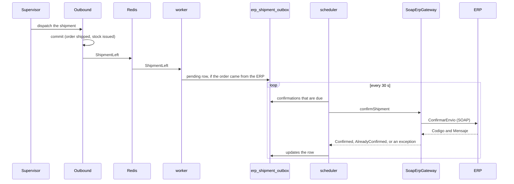
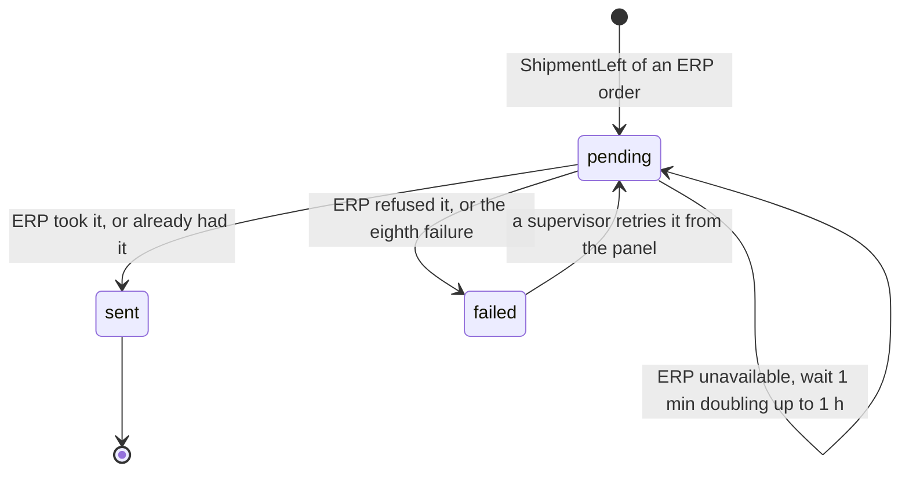

# ERP integration

How Estiba and the legacy ERP exchange orders and shipments. The decisions are in [ADR 0051](../adr/0051-the-erp-integration-as-a-whole.md) and, for each part, in ADRs [0046](../adr/0046-a-simulated-legacy-erp.md) to [0050](../adr/0050-an-integration-panel-and-a-contract-test-for-the-erp.md). The contract with the ERP is in [erp-legacy/README.md](../../erp-legacy/README.md) and the code in [backend/src/Erp](../../backend/src/Erp/README.md).

## The pieces

What runs, and who talks to whom. The ERP and its SFTP server are the simulated ones and only start with `make erp-up`.

Inside the `Erp` context, the ERP's words are known in two adapters and one translator, and nowhere else:

The `Erp` context depends on the contracts of Catalog, Outbound and Warehouse (ADR 0003). Nothing depends on it.

## An order comes in

Every 30 seconds. The ERP leaves a file once and never again, and Estiba moves it when it is done with it.

What happens to a file:

| Situation | Result |
|---|---|
| Its orders were registered, or already were | `processed/` |
| It is malformed, names an unknown article, or Outbound refuses the order | `rejected/` with a warning. The other files go on |
| SFTP, the database or anything else that is not the file's fault fails | The file stays. The run stops and the next one starts over |

## A shipment goes back

The dispatch does not wait for the ERP. Only orders that came from the ERP are queued.

The ERP's codes, as the gateway sees them:

| `Codigo` | Meaning | Becomes |
|---|---|---|
| 0 | Shipment recorded | `Confirmed` |
| 1 | Already confirmed | `AlreadyConfirmed`, a success |
| 3 | Not exported yet | `ErpUnavailable`: try again |
| 2, 4, 5, 6, 7, any other, or a fault that blames the message | Refused | `ErpRejectedShipment`: do not try again |
| A fault of the server, or no connection | | `ErpUnavailable` |

## Life of a confirmation

The states of a row in `erp_shipment_outbox`.

A retry from the panel puts the row back to `pending`, with the attempts at zero and due now. It does not call the ERP itself: the job is the only sender, so a person and the schedule never send the same confirmation at once.

## Where to look when something is wrong

| Question | Where |
|---|---|
| What did the ERP send, and was it taken? | Screen "Integración ERP", imports. Table `erp_import_log`. The `processed/` and `rejected/` folders of the SFTP server |
| Was the shipment confirmed? | The same screen, confirmations. `select order_reference, status, attempts, last_error from erp_shipment_outbox;` |
| Is the schedule running? | `make erp-logs` |
| Run an import or a send now | `docker compose exec php bin/console app:erp:import-orders` and `app:erp:send-confirmations` |
| Is the ERP itself fine? | `make erp-check` |
