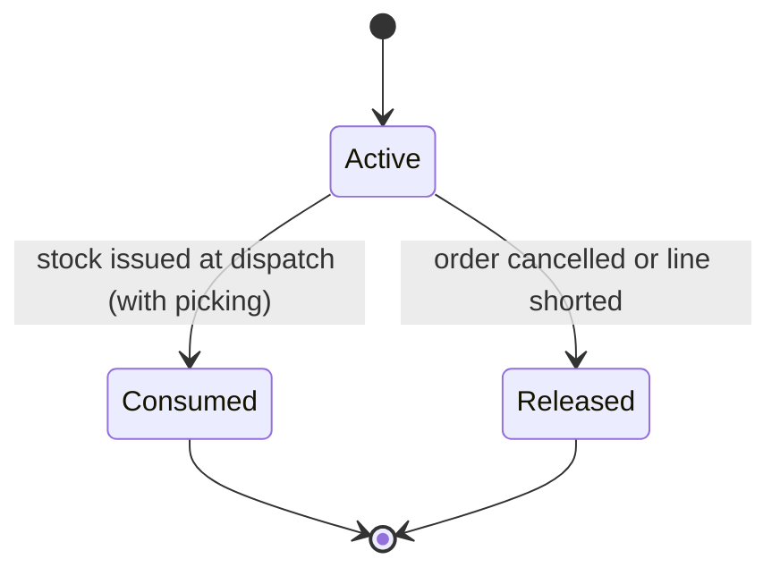
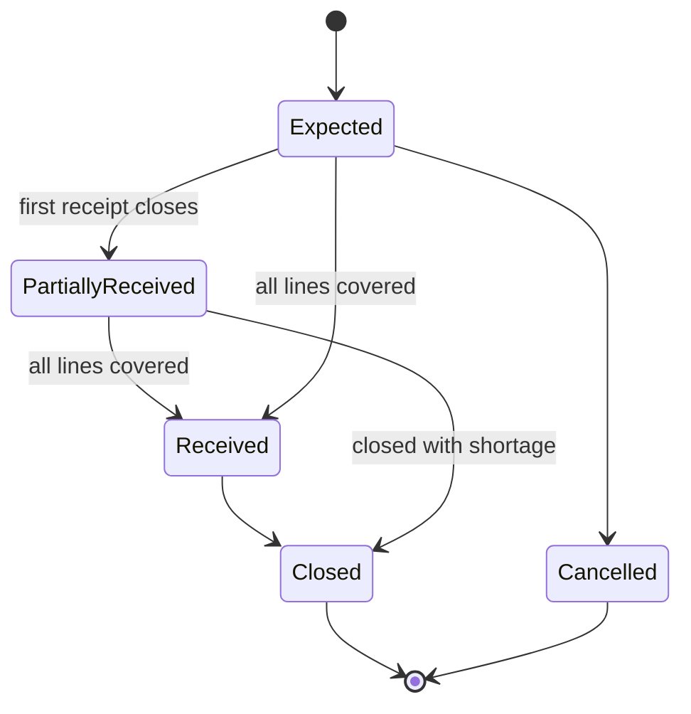
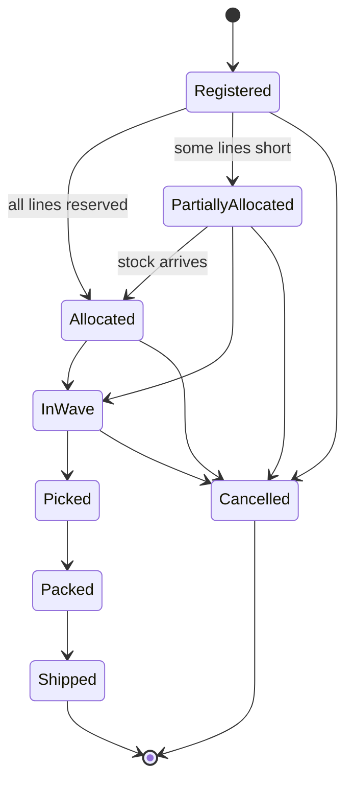
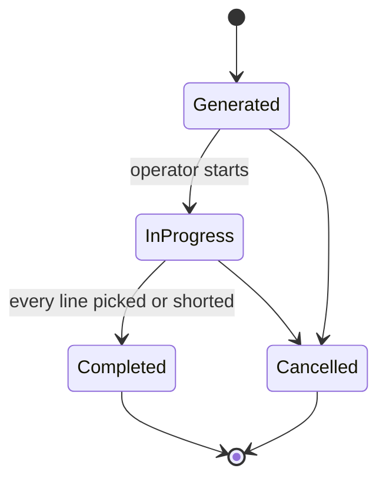
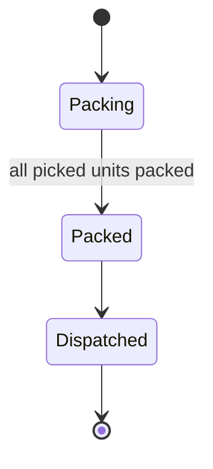

# Aggregates and invariants

An aggregate is the unit that is loaded, changed and saved as a whole, and the unit that protects its own rules. Each rule has an identifier so tests and code comments can point to it, for example `// STK-01`.

Every aggregate, except the tenant itself, carries a `TenantId`. Identifiers are UUID v7. A context refers to another context's aggregate by identifier only (ADR 0003).

## Identity

### Tenant

Identity: `TenantId`, the same identifier every other aggregate carries. Holds the name and the default language, which is the language used where no request says otherwise (background jobs, printed documents).

| ID | Invariant |
|---|---|
| IDN-07 | The name has 1 to 100 characters and no control characters. |

### User

Identity: `UserId`. Holds the tenant, the email address, the password hash, the roles and the status (active or disabled). Roles are `admin`, `supervisor` and `operator`, and each includes the ones below it. A user is created with `User::register()`, which checks IDN-01 through the `EmailRegistry`.

| ID | Invariant |
|---|---|
| IDN-01 | An email address belongs to one user in the whole system, ignoring case. A unique database constraint backs the check against races. |
| IDN-02 | An email address is valid, at most 254 characters, and is kept in lower case. |
| IDN-03 | A password has 12 to 72 characters (72 is bcrypt's limit in bytes). It exists as plain text only inside `PlainPassword`, which cannot be printed, logged or serialized, and only a hash is ever stored. |
| IDN-04 | A user has at least one role. |
| IDN-05 | A user belongs to one tenant for its whole life: nothing can move it. |
| IDN-06 | A disabled user cannot sign in, and a token it already holds stops working at once, because the user is loaded on every request. Enforced by the security layer's user checker. |

## Catalog

### Product

Identity: `ProductId`. Holds the `Sku`, the GTINs, the base unit, the packaging levels, the tracking policy, the storage class and the status (active, blocked, discontinued).

| ID | Invariant |
|---|---|
| CAT-01 | The SKU is unique per tenant, ignoring case and surrounding spaces. |
| CAT-02 | Every GTIN passes the GS1 check digit and belongs to one product of the tenant. |
| CAT-03 | The base unit has quantity 1. Every packaging level holds a positive whole number of base units, and each level is larger than the one before. |
| CAT-04 | A product tracked by expiry date is also tracked by lot. |
| CAT-05 | The tracking policy is fixed when the product is registered. A product that needs another policy is registered again under a new SKU. |
| CAT-06 | A blocked or discontinued product cannot be received or allocated. Consumers read the status from the product snapshot. |
| CAT-07 | The minimum shelf life, at receipt and at shipment, applies only to products tracked by expiry date and is zero or more days. |
| CAT-08 | A discontinued product is final: it cannot be blocked, unblocked or changed. Products are never deleted, because stock history and orders refer to them. |
| CAT-09 | The length, width, height (millimetres) and weight (grams) of the base unit are positive whole numbers. |

GTIN-8, GTIN-12, GTIN-13 and GTIN-14 are all accepted. The same item printed as a UPC and as an EAN with a leading zero is one GTIN, so uniqueness (CAT-02) compares the numbers padded to 14 digits.

## Warehouse

### Warehouse

Identity: `WarehouseId`. Holds its zones (`ZoneId`, code, name, storage class, picking sequence). A warehouse has few zones, so they live inside it.

| ID | Invariant |
|---|---|
| WH-01 | The warehouse code is unique per tenant. |
| WH-02 | A zone code is unique within its warehouse. |

### Location

Identity: `LocationId`. A separate aggregate, because a warehouse has thousands of locations. Holds the warehouse and zone identifiers, the `LocationCode`, the type, the capacity (maximum weight, volume, pallet positions), the pick sequence and the status (active, blocked, with a reason).

| ID | Invariant |
|---|---|
| WH-03 | The location code matches `aisle-module-level` and is unique within its warehouse. |
| WH-04 | Every capacity value is positive. |
| WH-05 | The zone belongs to the location's warehouse. |
| WH-06 | A blocked location is never offered for putaway or allocation. Consumers read the status from the location snapshot. |
| WH-07 | Locations are never deleted, only blocked, because stock history refers to them (DD-4). |

A location is created only through `Warehouse::defineLocation()`, which checks WH-03 and WH-05.

WH-01 and WH-03 need to know about other aggregates (the other warehouses of a tenant, the other locations of a warehouse). The factory receives a small registry interface (`WarehouseCodeRegistry`, `LocationCodeRegistry`), so the rule is enforced in the domain and a unit test can fake it. A unique database constraint backs it against two requests racing each other.

## Inventory

### StockItem

Identity: `StockItemId`, with a unique constraint on tenant, product, location, lot, expiry date and status (DD-1). Holds `onHand`, `reserved`, the moment units first arrived (`firstReceivedAt`, which orders stock for FIFO) and a version for optimistic locking. Reserving units moves none of them, so it records no movement; every change of `onHand` appends a `StockMovement` row (type, quantity change, reference, reason, author, time). Two requests that change the same stock item cannot both succeed: the second one is refused when it saves (answered as `shared.concurrent_update`, 409), which is what keeps two orders from promising the same units.

| ID | Invariant |
|---|---|
| STK-01 | `onHand` is never negative. |
| STK-02 | `reserved` never exceeds `onHand`. Units that are promised cannot be issued, adjusted away or transferred, and a version stops two concurrent reservations from both winning. A database `CHECK` backs it. |
| STK-03 | Every change of `onHand` is recorded by exactly one movement, in the same transaction. |
| STK-04 | A movement is never updated or deleted. A mistake is fixed with a compensating movement. |
| STK-05 | The sum of a stock item's movements equals its `onHand`. A reconciliation test checks it. |
| STK-06 | Only stock in available status, in an active reserve or pick face location, can be reserved. Stock at a dock, in staging or in quarantine is not offered. |
| STK-07 | Lot and expiry date are present exactly when the product's tracking policy asks for them. |
| STK-08 | A transfer takes from one stock item and adds to another, both or neither. |
| STK-09 | An adjustment needs a reason and an author. |
| STK-10 | Reserved units cannot change stock status. |

### StockReservation

Identity: `ReservationId`. Holds the reference of what it serves (an opaque text, for an order line `order:<orderId>:<lineNumber>`), the product, the requested quantity, the strategy (FEFO or FIFO), the allocations (stock item and quantity) and the status. A reference has one reservation: asking again tops it up and never reserves twice. The quantity asked at first cannot change.

| ID | Invariant |
|---|---|
| STK-11 | The allocated quantity is the sum of the allocations and never exceeds the requested quantity. Allocating less is allowed, and the shortage is reported. |
| STK-12 | Stock is chosen by earliest expiry date first for expiry-tracked products (FEFO), then by earliest receipt date (FIFO). Stock that would expire before the product's minimum shelf life at shipment, counted from the day of the allocation, is skipped. Stock that never expires goes after stock that does. Equal stock is chosen by identifier, so the plan is repeatable. |
| STK-13 | A reservation is consumed once. Units that were not picked go back to available. |
| STK-14 | Releasing a reservation is safe to repeat: the second release gives nothing back. A released reservation takes no more units. |

## Inbound

### Asn

Identity: `AsnId`. Holds the supplier, the expected date, the external reference, the lines (product, expected quantity, received quantity, optional lot and expiry) and the receipt in progress, if any. Receipts are opened and closed through the ASN, so it adds what each receipt counted to its lines and moves through its statuses by itself.

| ID | Invariant |
|---|---|
| INB-01 | Every line's product exists and is active. |
| INB-02 | Expected quantities are positive whole numbers of the base unit. |
| INB-03 | The external reference is unique per tenant, so importing the same ASN twice changes nothing. |
| INB-04 | A closed or cancelled ASN cannot be received against. |
| INB-15 | An ASN has at least one line, and a product appears on one line only. |
| INB-16 | An ASN has at most one open receipt. It cannot be cancelled or closed while a receipt is open. |

### Receipt

Identity: `ReceiptId`. Holds the ASN, the dock location, what it expects of each product (the units of each ASN line still to come when it opened), the received lines (product, quantity, lot, expiry, condition) and the status (open, closed). Discrepancies are derived by comparing received and expected quantities: shortage, excess, unexpected product and damaged units. They are never stored, so they cannot disagree with the counts.

| ID | Invariant |
|---|---|
| INB-05 | A receipt belongs to exactly one ASN. |
| INB-06 | A scanned GTIN that is not on the ASN is recorded as an unexpected-product discrepancy. It is not refused. |
| INB-07 | Lot and expiry date are required when the product tracks them, and the expiry date is not in the past. |
| INB-08 | Receiving more than the ASN quantity is a discrepancy. Closing the receipt then needs supervisor approval. The default tolerance is zero. An unexpected product counts as more than the ASN quantity, and receiving more of a product that is already over withdraws the approval. |
| INB-09 | A closed receipt cannot change, and closing it publishes `ReceiptClosed` once. |
| INB-10 | Damaged goods enter stock in quarantine status, never available. |

### PutawayTask

Identity: `PutawayTaskId`. Holds the receipt, the ASN reference, the goods (product, quantity, lot, expiry and whether they are in quarantine), the source dock, the suggested location, the actual location, an override reason, who confirmed it and the status (pending, confirmed). Tasks are planned when a receipt closes, one for each product, lot, expiry date and condition it brought, at the location the configured putaway strategy suggests (ADR 0011). Damaged goods go to quarantine locations, the rest to reserve or pick faces.

| ID | Invariant |
|---|---|
| INB-11 | The destination is an active location of a type that stores the goods (quarantine for damaged goods, reserve or pick face for the rest), whose zone suits the product's storage class and which has room for the quantity by weight and volume. It is not the dock the goods are on. |
| INB-12 | Confirming moves exactly the task quantity. A smaller move is made by splitting the task first. |
| INB-13 | Choosing a location other than the suggested one needs a reason. A task without a suggestion needs none. |
| INB-14 | The putaway tasks of a receipt's goods add up to exactly the quantity received: splitting a task moves units to a new task and never loses any. |

## Outbound

### Order

Identity: `OrderId`. Holds the external reference, the warehouse it is served from, the customer, the ship-to address, the priority (low, normal, high, urgent), the cut-off time and the lines (a line number from 1, the product, and the ordered and allocated quantities, plus the reservation that holds the stock; picked and shipped quantities arrive with picking and shipping). Allocating an order asks Inventory for one reservation per line that is not fully covered, and doing it again tops them up.

| ID | Invariant |
|---|---|
| OUT-01 | The external reference is unique per tenant, so importing the same order twice changes nothing. |
| OUT-02 | Ordered quantities are positive whole numbers of the base unit, and the product is active. |
| OUT-03 | For every line, allocated never exceeds ordered, picked never exceeds allocated, and shipped never exceeds picked. |
| OUT-04 | Cancelling an order releases its reservations, in the same transaction. A cancelled order cannot be cancelled or allocated again. A shipped order cannot be cancelled (shipping arrives later). |
| OUT-05 | An order belongs to at most one open wave. |

### Wave

Identity: `WaveId`. Holds the orders and the status (planned, released, completed, cancelled).

| ID | Invariant |
|---|---|
| OUT-06 | Only orders that are allocated, or partially allocated with the backorder accepted, can join a wave. |
| OUT-07 | Once released, the orders of a wave cannot change. |
| OUT-08 | A wave completes when all its pick lists are completed or cancelled. |

### PickList

Identity: `PickListId`. Holds the wave, the assigned operator and the lines (order line, product, location, lot, expiry, quantity to pick, quantity picked).

| ID | Invariant |
|---|---|
| OUT-09 | Lines follow the serpentine route: pick sequence ascending in odd aisles, descending in even aisles. |
| OUT-10 | The picked quantity never exceeds the quantity to pick. Picking less is a short pick and needs a reason. |
| OUT-11 | Each pick is confirmed by scanning the location, then the product, and the lot when the product is tracked. All must match the line. |
| OUT-12 | A pick list has one assigned operator at a time. |
| OUT-13 | The list is complete only when every line is picked or shorted. |

### Shipment

Identity: `ShipmentId`. Holds the order, the carrier and the parcels (`SSCC`, contents, weight, open or closed).

| ID | Invariant |
|---|---|
| OUT-14 | The SSCC passes the GS1 check digit, is unique, and is assigned once, when the parcel is closed. |
| OUT-15 | For every product, the packed quantity never exceeds the picked quantity. |
| OUT-16 | A shipment is packed only when all picked units are in parcels. |
| OUT-17 | A dispatched shipment cannot change. |

## Rules that span contexts

These cannot be guaranteed inside one aggregate. Each is handled by a policy or a contract call, and the table says how strong the guarantee is.

| Rule | How it holds | Guarantee |
|---|---|---|
| Stock is booked when a receipt closes | `ReceiptClosed` triggers `ReceiveStock` | Eventually, with retries |
| An order is allocated when it is registered | `OrderRegistered` triggers a call to the Inventory contract | Eventually, with retries |
| Reservations are released when an order is cancelled | `OrderCancelled` triggers the release | Eventually, with retries |
| Putaway goes only to an active, suitable location | `ConfirmPutaway` reads the location snapshot in the same request | Checked at the moment of the call |
| Stock never goes negative | `StockItem` enforces STK-01 on every change | Always |
