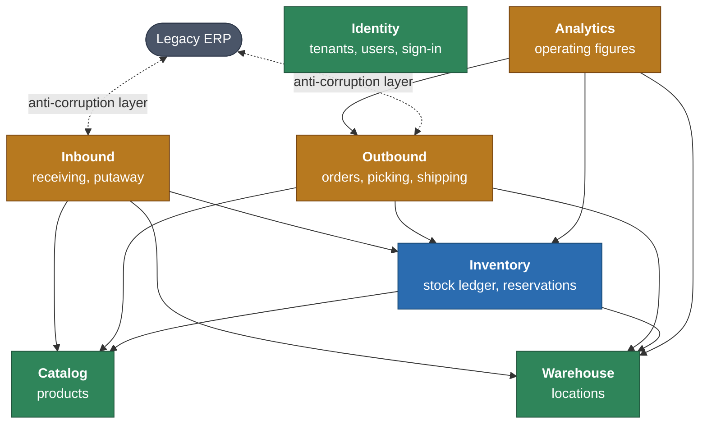

# Context map

How the bounded contexts depend on each other, and what each one publishes. The rules come from [ADR 0001](../adr/0001-modular-monolith-with-hexagonal-bounded-contexts.md) and [ADR 0003](../adr/0003-cross-context-communication-through-published-contracts.md).

## Dependencies

An arrow means "depends on". There are no cycles (DD-7).

| Context | Role | Depends on |
|---|---|---|
| Identity | Upstream. Who may use the system, and for which tenant. Nothing depends on it: the other contexts learn the tenant through the `CurrentTenant` port in `Shared`. | Nothing |
| Catalog | Upstream. Defines what the warehouse handles. | Nothing |
| Warehouse | Upstream. Defines where stock can go. | Nothing |
| Inventory | Core. The authority on how much stock exists and where. | Catalog, Warehouse |
| Inbound | Downstream. Brings goods in. | Catalog, Warehouse, Inventory |
| Outbound | Downstream. Sends goods out. | Catalog, Warehouse, Inventory |
| Analytics | Downstream, read only. Puts together the figures a supervisor looks at (orders, picking speed, short picks, stock by status, occupancy of the storage locations). It owns no table: each context answers for its own data through a contract and Analytics adds and divides ([ADR 0043](../adr/0043-operating-figures-asked-from-each-context.md)). Nothing depends on it. | Warehouse, Inventory, Outbound |
| Audit | Observer. Writes down every domain event of the others and answers who did what. It reads them through the event bus and knows none of them, so it depends on nothing and nothing depends on it ([ADR 0018](../adr/0018-audit-trail-of-every-domain-event.md)). | Nothing |

Inbound and Outbound talk to the ERP through an anti-corruption layer (E08), so the ERP's model never reaches the domain.

## Published contracts

Everything below lives in the context's `Application/Contract` namespace. Other contexts may use these and nothing else. Names are a design sketch; signatures settle when each context is implemented.

### Identity

None. The other contexts need no contract from it. The tenant of a request reaches them through the `CurrentTenant` port in `Shared`, which Identity implements from the signed-in user ([ADR 0008](../adr/0008-jwt-authentication-and-tenancy-from-the-signed-in-user.md)).

### Catalog

| Contract | Purpose |
|---|---|
| `ProductCatalog` | Find a product by id or GTIN and return a `ProductSnapshot` (id, SKU, name, storage class, tracking policy and shelf lives, whether it is available for operations, family, turnover class, dimensions). In use since E03-03; SKU lookup, base unit and packaging levels come when a context needs them. |
| `ProductRegistered`, `ProductBlocked` | Integration events |

### Warehouse

| Contract | Purpose |
|---|---|
| `LocationDirectory` | Find a location by id, or list the active locations of a warehouse of some types in the order of the picking route. Returns a `LocationSnapshot` (id, code, warehouse and its code, zone, type, status, the zone's storage class and families, pick sequences, weight and volume limits). In use since E03-03 (docks) and E03-04 (putaway). |
| `WarehouseDirectory` | Find a warehouse by id and return a `WarehouseSnapshot` (id, code, name). In use since E04-01, to check where an order is served from. |
| `LocationCensus` | The ids of the active storage locations (reserve and pick face) of all the warehouses of the tenant, to tell how many hold stock. In use since E07-04. |
| `LocationBlocked`, `LocationUnblocked` | Integration events |

### Inventory

| Contract | Purpose |
|---|---|
| `StockMovements` | `receive`, `transfer`, `issue` and `adjust` stock. Called by Inbound, Outbound and the adjustment screens. `receive` and `transfer` are in use since E03-04 (receipts and putaway). |
| `StockLevels` | What each location holds, by product. Putaway uses it to tell empty locations and room (E03-04). |
| `StockReservations` | `allocate` units for a reference such as an order line (returns the reservation, the units it holds and the shortage) and `release` a reservation. Both in use since E04-01 ([ADR 0014](../adr/0014-reservations-without-movements-and-allocation-by-plan.md)). `stockOf` says where the units of a reservation are, with their lot and expiry date, for pick lists (E04-02). `pick` records a pick: it moves the units taken to a staging location, keeps them promised, and gives up the ones not found (E04-03, [ADR 0016](../adr/0016-confirming-picks-and-moving-the-stock-to-staging.md)). `consume` issues what a reservation holds when the order is dispatched, and ends the reservation (E04-06, [ADR 0020](../adr/0020-dispatching-a-shipment-issues-the-stock.md)). |
| `StockKpis` | The units on hand by status across the tenant, and how many of some locations hold stock, read from the stock overview. In use since E07-04. |
| `StockAvailability` | Read on-hand, reserved and available for a product, optionally by warehouse or location |
| `StockLevelChanged`, `StockBelowThreshold` | Integration events for read models, dashboards and notifications. Inside Inventory, the stock read model already follows `StockMovementRecorded` (ADR 0013). |

### Inbound

| Contract | Purpose |
|---|---|
| `ReceiptClosed` | Integration event. Used for the ERP export. |
| `PutawayConfirmed` | Integration event, used by dashboards |

### Audit

None. It publishes no contract and uses none: it describes any event by reflection ([ADR 0018](../adr/0018-audit-trail-of-every-domain-event.md)).

### Outbound

| Contract | Purpose |
|---|---|
| `OutboundKpis` | Orders open, registered and shipped, and what the pick lists completed in a period say: stops, units, short picks and time spent. Plain SQL over Outbound's own tables. In use since E07-04. |
| `OrderAllocated`, `OrderCancelled` | Integration events |
| `ShipmentDispatched` | Integration event. Triggers the stock issue and the ERP confirmation. |

## Enforcement

`ArchitectureTest` holds the table above as its `DEPENDS_ON` map. A context may reach another one only if it is listed, and then only through that context's `Application/Contract`. Every other dependency fails `make stan`, so a cycle cannot be merged. Adding a dependency means changing this document and the map in the same pull request.
