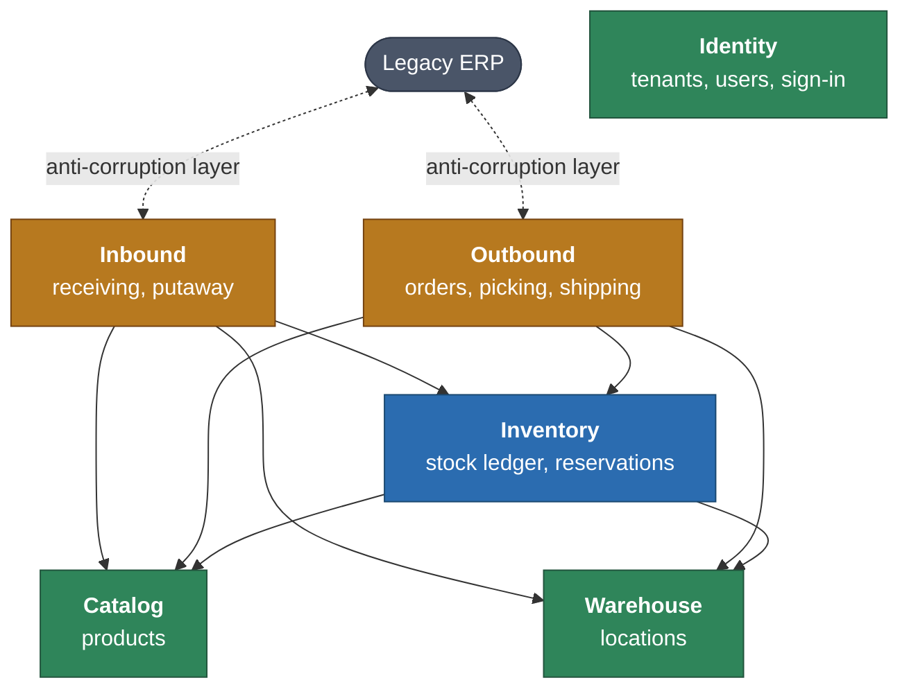

# Context map

How the five bounded contexts depend on each other, and what each one publishes. The rules come from [ADR 0001](../adr/0001-modular-monolith-with-hexagonal-bounded-contexts.md) and [ADR 0003](../adr/0003-cross-context-communication-through-published-contracts.md).

## Dependencies

An arrow means "depends on". There are no cycles (DD-7).

| Context | Role | Depends on |
|---|---|---|
| Identity | Upstream. Who may use the system, and for which tenant. Nothing depends on it: the other contexts learn the tenant through the `CurrentTenant` port in `Shared`. | Nothing |
| Catalog | Upstream. Defines what the warehouse handles. | Nothing |
| Warehouse | Upstream. Defines where stock can go. | Nothing |
| Inventory | Core. The authority on how much stock exists and where. | Catalog, Warehouse |
| Inbound | Downstream. Brings goods in. | Catalog, Warehouse, Inventory |
| Outbound | Downstream. Sends goods out. | Catalog, Warehouse, Inventory |

Inbound and Outbound talk to the ERP through an anti-corruption layer (E08), so the ERP's model never reaches the domain.

## Published contracts

Everything below lives in the context's `Application/Contract` namespace. Other contexts may use these and nothing else. Names are a design sketch; signatures settle when each context is implemented.

### Identity

None. The other contexts need no contract from it. The tenant of a request reaches them through the `CurrentTenant` port in `Shared`, which Identity implements from the signed-in user ([ADR 0008](../adr/0008-jwt-authentication-and-tenancy-from-the-signed-in-user.md)).

### Catalog

| Contract | Purpose |
|---|---|
| `ProductCatalog` | Find a product by id or GTIN and return a `ProductSnapshot` (id, SKU, storage class, tracking policy, whether it is available for operations). In use since E03-03; SKU lookup, base unit and packaging levels come when a context needs them. |
| `ProductRegistered`, `ProductBlocked` | Integration events |

### Warehouse

| Contract | Purpose |
|---|---|
| `LocationDirectory` | Find a location by id or by code, or list candidates for a criteria (zone, type, status). Returns a `LocationSnapshot` (id, code, zone, type, capacity, pick sequence, status). Lookup by id is in use since E03-03 (the dock of a receipt); the rest comes with putaway (E03-04). |
| `LocationBlocked`, `LocationUnblocked` | Integration events |

### Inventory

| Contract | Purpose |
|---|---|
| `StockMovements` | `receive`, `transfer`, `issue` and `adjust` stock. Called by Inbound, Outbound and the adjustment screens. |
| `StockReservations` | `allocate` an order line (returns the reservation and any shortage), `release` and `consume` |
| `StockAvailability` | Read on-hand, reserved and available for a product, optionally by warehouse or location |
| `StockLevelChanged`, `StockBelowThreshold` | Integration events for read models, dashboards and notifications |

### Inbound

| Contract | Purpose |
|---|---|
| `ReceiptClosed` | Integration event. Used for the ERP export. |
| `PutawayConfirmed` | Integration event, used by dashboards |

### Outbound

| Contract | Purpose |
|---|---|
| `OrderAllocated`, `OrderCancelled` | Integration events |
| `ShipmentDispatched` | Integration event. Triggers the stock issue and the ERP confirmation. |

## Enforcement

`ArchitectureTest` holds the table above as its `DEPENDS_ON` map. A context may reach another one only if it is listed, and then only through that context's `Application/Contract`. Every other dependency fails `make stan`, so a cycle cannot be merged. Adding a dependency means changing this document and the map in the same pull request.
