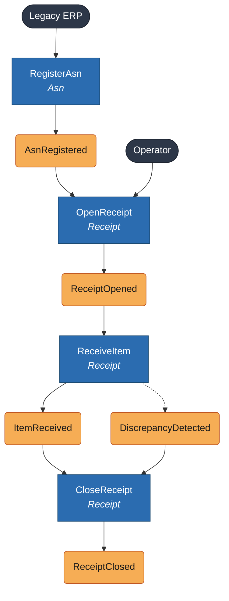
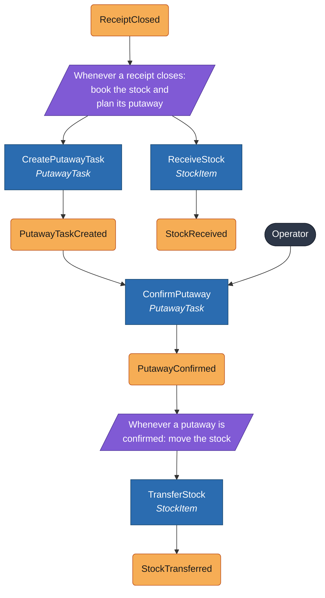
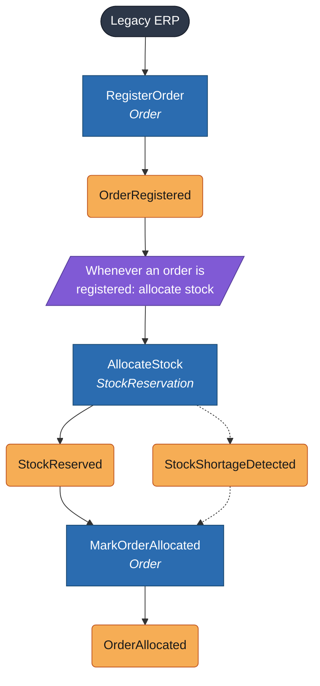
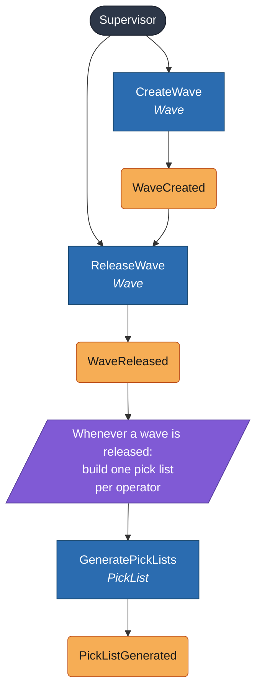
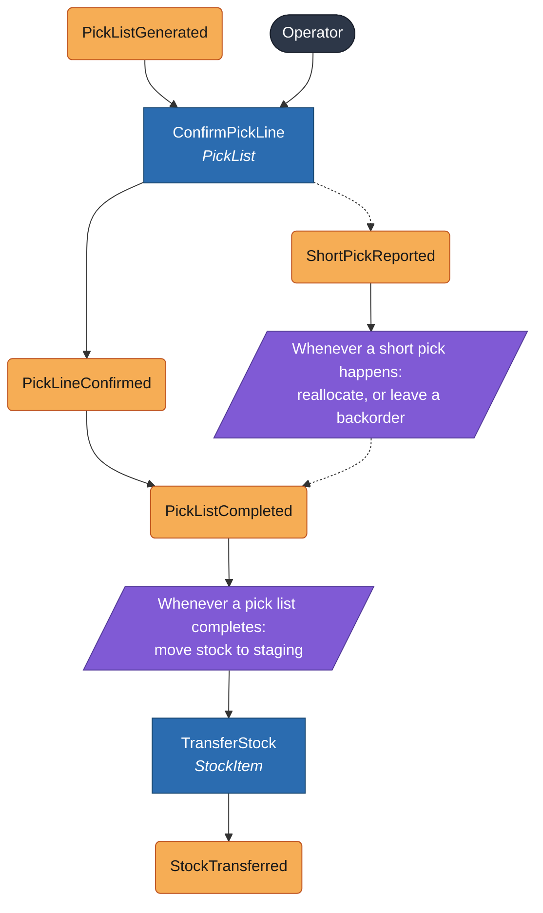
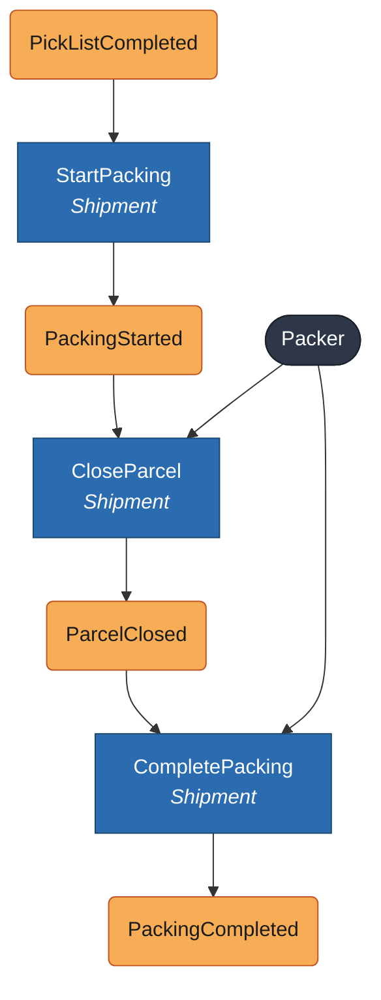
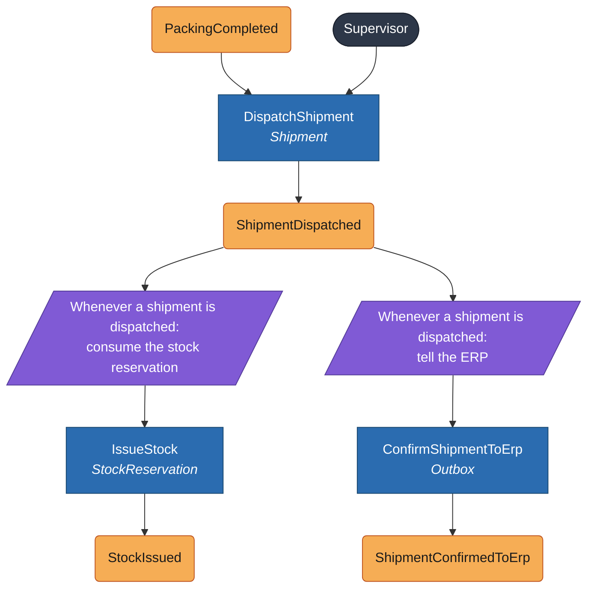

# Event storming

What happens in the warehouse, in order. Each flow reads from top to bottom and is cut into short diagrams so it stays readable.

| Shape | Meaning |
|---|---|
| Orange rounded box | **Event**: something that happened, in the past tense |
| Blue box | **Command**: a request to do something. The second line is the aggregate that handles it. |
| Purple slanted box | **Policy**: "whenever this event happens, do that" |
| Dark stadium | A person or external system that starts the flow |

A dashed arrow is an alternative outcome. Events published to other contexts are listed in the [context map](context-map.md).

## 1. Receiving and putaway

### 1.1 Receiving

| Command | Started by | Handled by | Rejected when |
|---|---|---|---|
| `RegisterAsn` | ERP import | `Asn` | The ASN reference already exists, a product is unknown or blocked, or a quantity is not positive |
| `OpenReceipt` | Operator | `Asn` | The ASN is closed or cancelled, or already has an open receipt. The location is not an active dock. |
| `ReceiveItem` | Operator scans a GTIN | `Receipt` | No product carries the GTIN, the product is blocked, a lot or expiry is missing for a tracked product (or given for an untracked one), or the expiry date has passed. A product that is not on the ASN is recorded as a discrepancy, not refused. |
| `ApproveOverReceipt` | Supervisor | `Receipt` | The receipt holds no more than the ASN announced, or the approval was already given |
| `CloseReceipt` | Operator | `Asn` | There are unapproved over-receipts. A supervisor must approve them first. |

Discrepancies found while receiving: shortage, excess, unexpected product, damaged goods. Damaged goods enter stock as *quarantine*, not *available*.

### 1.2 Booking the stock and putaway

| Command | Started by | Handled by | Rejected when |
|---|---|---|---|
| `ReceiveStock` | Policy on `ReceiptClosed` | `StockItem` | Never refused: the receipt already checked the goods. Damaged units go to quarantine. |
| `CreatePutawayTask` | Policy on `ReceiptClosed` | `PutawayTask` | Never refused. Without a free location the task has no suggestion and the operator chooses. |
| `SplitPutawayTask` | Operator | `PutawayTask` | The task is confirmed, or one side would be left with no units |
| `ConfirmPutaway` | Operator scans the location | `PutawayTask` | The location is unknown, blocked, of a type that does not store the goods, incompatible with the product's storage class, has no room, or is the dock itself. Another location than the suggested one without a reason. |
| `TransferStock` | Policy on `PutawayConfirmed` | `StockItem` | The source would go below zero |

## 2. Order to picking

### 2.1 Allocation

| Command | Started by | Handled by | Rejected when |
|---|---|---|---|
| `RegisterOrder` | ERP import | `Order` | The external reference already exists, a quantity is not positive, or a product is blocked |
| `AllocateStock` | Policy | `StockReservation` | Never rejected for lack of stock. It reserves what exists and reports the shortage. |
| `MarkOrderAllocated` | Policy | `Order` | The order is cancelled |

With a shortage the order becomes *partially allocated* and the missing quantity stays as a **backorder**.

### 2.2 Waves

| Command | Started by | Handled by | Rejected when |
|---|---|---|---|
| `CreateWave` | Supervisor | `Wave` | An order is not allocated, or already belongs to an open wave |
| `ReleaseWave` | Supervisor | `Wave` | The wave has no orders |
| `GeneratePickLists` | Policy | `PickList` | Never rejected |

In the code the pick lists are made by `ReleaseWave` itself, in the same transaction, and not by a policy after the commit ([ADR 0015](../adr/0015-waves-and-pick-lists-in-serpentine-order.md)): a wave is never on the floor without its lists, and the supervisor gets them in the answer.

### 2.3 Picking

| Command | Started by | Handled by | Rejected when |
|---|---|---|---|
| `ConfirmPickLine` | Operator scans location, product and lot | `PickList` | The scan does not match the line, or more is picked than asked |
| `TransferStock` | Policy on `PutawayConfirmed` | `StockItem` | The source would go below zero |

In the code, `ConfirmPickLine` moves the picked units to staging at once, one stop at a time, and not in a policy when the list completes ([ADR 0016](../adr/0016-confirming-picks-and-moving-the-stock-to-staging.md)). A short pick gives up the units that were not found: they stop being promised and become part of the shortage of the order line, and the policy below is left to a supervisor, who can allocate the order again and put it in another wave.

On a short pick the policy first tries to allocate the missing quantity from other stock. If there is none, the order line keeps the missing quantity as a backorder and the rest of the order continues.

## 3. Packing and dispatch

### 3.1 Packing

| Command | Started by | Handled by | Rejected when |
|---|---|---|---|
| `StartPacking` | Policy | `Shipment` | The order has nothing picked |
| `CloseParcel` | Packer | `Shipment` | The parcel is empty, or it holds more than was picked |
| `CompletePacking` | Packer | `Shipment` | Picked quantities are not all packed |

Closing a parcel assigns its SSCC and produces its label.

### 3.2 Dispatch

| Command | Started by | Handled by | Rejected when |
|---|---|---|---|
| `DispatchShipment` | Supervisor or carrier handover | `Shipment` | Packing is not complete |
| `IssueStock` | Policy | `StockReservation` | The reservation was already consumed |
| `ConfirmShipmentToErp` | Policy | Outbox | Never rejected. It retries until the ERP accepts it. |

## 4. Corrections and layout changes

Smaller flows that need no diagram.

| Command | Started by | Handled by | Event | Notes |
|---|---|---|---|---|
| `AdjustStock` | Supervisor | `StockItem` | `StockAdjusted` | Needs a reason. Cannot make stock negative. Creates a compensating movement, never edits an old one. |
| `ChangeStockStatus` | Supervisor | `StockItem` | `StockStatusChanged` | Moves units between available, quarantine, damaged and on hold. Reserved units cannot change status. |
| `BlockLocation` | Supervisor | `Location` | `LocationBlocked` | The location stops receiving putaways and allocations. Stock already in it stays. |
| `UnblockLocation` | Supervisor | `Location` | `LocationUnblocked` | |
| `BlockProduct` | Supervisor | `Product` | `ProductBlocked` | The product cannot be received or allocated. Existing reservations stand. |
| `UnblockProduct` | Supervisor | `Product` | `ProductUnblocked` | Rejected if the product is not blocked or is discontinued. |
| `DiscontinueProduct` | Supervisor | `Product` | `ProductDiscontinued` | Final (CAT-08). Works from active or blocked. |
| `CancelOrder` | ERP or supervisor | `Order` | `OrderCancelled` | Policy: whenever an order is cancelled, release its reservations. Not allowed after dispatch. |
